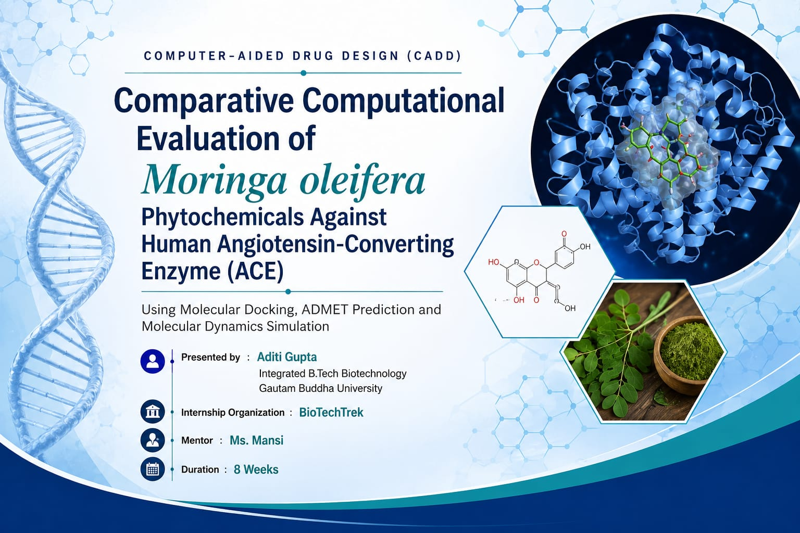

# 🧬 Computational Evaluation of Moringa oleifera Phytochemicals Against Human ACE

## 📌 Project Overview

This project investigates the potential of selected phytochemicals from *Moringa oleifera* as inhibitors of Human Angiotensin-Converting Enzyme (ACE) using computational drug discovery techniques.

---

## 🎯 Objectives

- Prepare Human ACE protein
- Prepare phytochemical ligands
- Perform molecular docking
- Compare docking scores with FDA-approved ACE inhibitors
- Predict ADMET properties
- Validate docking results using Molecular Dynamics Simulation

---

## 🛠️ Software Used

- PyRx
- AutoDock Vina
- PyMOL
- SwissADME
- GROMACS
- VMD

---

## 📊 Methodology

1. Protein Preparation
2. Ligand Preparation
3. Molecular Docking
4. ADMET Prediction
5. Molecular Dynamics Simulation
6. Result Analysis

---

## 📈 Results

The molecular docking, ADMET prediction, and molecular dynamics simulation results are documented in the project report and presentation.

Please refer to the following files for detailed results, analysis, and visualizations:

- [CADD Mini Project Report](AditiGupta_CADD_MiniProject.pdf)
- [CADD Project Presentation](AditiGupta_CADD_Presentation.pdf)

---

## 📚 Skills Demonstrated

- Molecular Docking
- Bioinformatics
- Drug Discovery
- Computational Biology
- Molecular Dynamics
- Python

---

## 👩‍💻 Author

**Aditi Gupta**

Integrated B.Tech Biotechnology Student

## 📂 Project Resources

- 📄 [CADD Mini Project Report](AditiGupta_CADD_MiniProject.pdf)
- 📊 [CADD Project Presentation](AditiGupta_CADD_Presentation.pdf)

